# Итоги проекта на 09.10.26

## Постановка задачи

Есть модель $M_\theta$, обученная на датасете $D$. Появляется запрос удалить
подмножество $D_f \subset D$ (набор для забывания), сохранив качество на остатке
$D_r = D \setminus D_f$. Требуется получить модель, которая ведет себя так, как если бы она
изначально обучалась только на $D_r$, но без переобучения с нуля.

Модель, обученная только на $D_r$, называется оракулом. Определение целевой функции:
$забыть$ $=$ $стать$ $неотличимой$ $от$ $оракула$.

## Обучение моделей

В проекте обучены 11 моделей одинаковой архитектуры на CIFAR-10: `full-baseline` (все 10 классов) и
`retain-oracle-c{0..9}` (все классы, кроме $c_{\text{forget}}$). `retain-oracle` - эталон того, какой должна
стать `full-baseline` после удаления класса $c_{\text{forget}}$.

Модели представляет собой 3-х блочную CNN с классификатором и имеют компактный объем, что позволяет быстро проводить эксперименты. Все обученные модели сохранены [здесь](https://www.kaggle.com/models/ycalkk/convolutional-unlearning). Архитектура моделей:

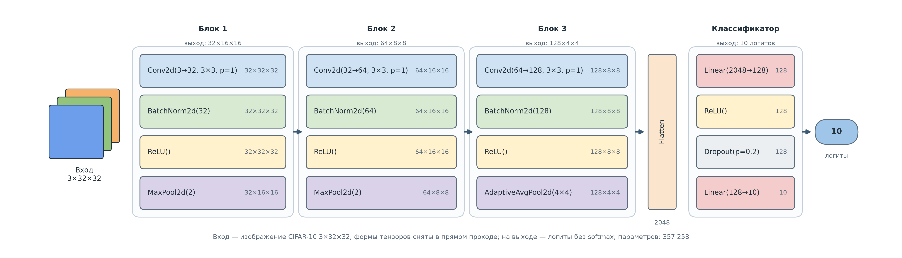

После обучения, из-за бага в цикле обучения, оказалось, что модели обучены на разных сидах, поэтому для исправления ноутбука
`learning.ipynb` был сделан модуль `train_all_models.py` и все модели были обучены заново, а в метаданные добавлена информация о настройках обучения и init хеше каждой модели.

## Сравнение метрик моделей

В ноутбуке `base_models_comparison.ipynb` были посчитаны некоторые метрики для каждой из моделей, по которым можно сделать несколько выводов.

### Дельта точности между оракулом и базовой модели

Эта метрика считает среднюю точность оракула на классах $\{0, 1, \dots, 9\} \setminus c_f$, то есть на всех классах кроме забытого и вычитает из нее точность базовой модели на этих же $9$ классах.

То есть для класса `airplane` возьмем airplane-оракула - модель, которая никогда не видела класс `airplane` и покажем ей все картинки с классами кроме самолета: `automobile`, `bird`, $\dots$, `truck`. Затем посчитаем среднюю точность на этих $9$ классах и проделаем тоже самое для базовой модели: покажем $9$ классов (все кроме самолета) и посчитаем среднюю точность, после - вычтем из точности оракула точность базовой модели.

|Забываемый класс|Дельта точности|
|----------------|---------------|
|airplane|0.015222|
|automobile|0.011444|
|bird|0.013222|
|cat|0.019556|
|deer|0.015889|
|dog|0.017889|
|frog|0.011889|
|horse|0.011111|
|ship|0.012889|
|truck|0.013889|

Средняя дельта точности $= 0.0143$, что означает, что в среднем все оракулы на $1.4\%$ точнее чем базовая модель на классах, кроме забытого, что приводит к выводу о том что после разобучения базовая модель должна стать точнее на оставшихся $9$ классах.

### Энтропия и предсказания оракулов на забытом классе

Энтропия на забытом классе показывает то на сколько не уверенно оракул отвечает, когда ему показывают класс, который он никогда не видел:

$$H = -\sum_{i=0}^{9} p_i \ln(p_i)$$

Максимальная энтропия достигается если оракул выдал для всех классов, кроме забытого $p \approx 0.1111\dots$, тогда энтропия будет $= ln(9) \approx 2.2$. У оракула на самом деле $10$ выходов, но один из них - это забытый класс, который на всех данных $<0.0001$, поэтому расчет максимальной энтропии учитывает только $9$ классов.

Энтропия оракула на забытом классе считается только на объектах, которые оракул никогда не видел. То есть для класса `airplane` берем airplane-оракула и считаем среднюю энтропию, показывая только самолеты. Для базовой модели тоже посчитаем энтропию по тому же принципу (для класса `airplane` считаем среднюю энтропию, показывая только самолеты).

|Забываемый класс|Энтропия оракула ($H_o$)|Энтропия базовой модели ($H_b$)|Дельта ($H_o$ - $H_b$)|
|----------------|------------------------|-------------------------------|----------------------|
|airplane|0.697911|0.379382|0.318529|
|automobile|0.513895|0.178962|0.334933|
|bird|0.860371|0.574063|0.286308|
|cat|0.755880|0.745398|0.010482|
|deer|0.930240|0.523815|0.406425|
|dog|0.689447|0.585199|0.104248|
|frog|0.874270|0.341508|0.532762|
|horse|0.868124|0.409514|0.458610|
|ship|0.601018|0.222354|0.378664|
|truck|0.496187|0.226639|0.269548|

Дельта всегда положительная. Это означает что, когда оракулу показывают класс, который он никогда не видел, то он менее уверен, в сравнение с базовой моделью. Наглядней это можно увидеть на двух следующих распределениях.

Распределение предсказаний базовой модели по классам. Элементы - это доля предсказаний класса, при показе определенного класса. Например, для класса `bird` модель в $0.05$ $(5\%)$ случаях относила птицу к `airplane`, в $0.74$ $(74\%)$ к `bird`, в $0.04$ $(4\%)$ к `cat` и т.д.

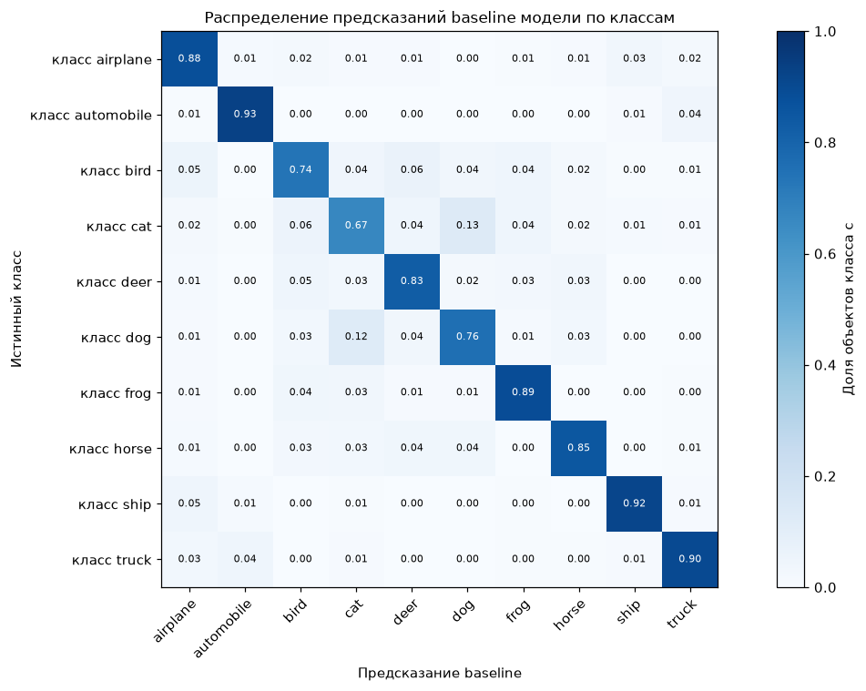

Распределение предсказаний для оракулов. Тоже, что и для базовой модели, но только для оракулов, которым показали их забытый класс. Например, для класса `bird` взяли bird-оракула и показали только птиц и модель в $0.20$ $(20\%)$ случаях относила птицу к классу `airplane`, в $0.15$ $(15\%)$ к `cat`, в $0.22$ $(22\%)$ к `deer` и т.д.

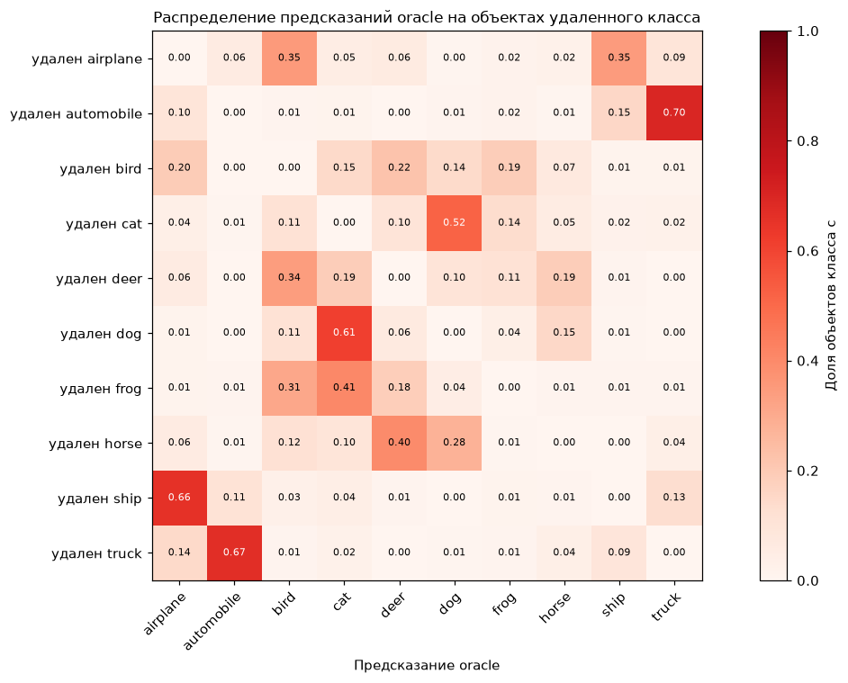

Это важное распределение - оно описывает, то к чему после unlearning должна прийти на выходах модель. Как описано в [этом](https://arxiv.org/abs/2607.19442) исследование KL-дивергенция (мера на сколько одно распределение вероятностей отличается от другого) эта важная метрика и настоящее забывание - это именно восстановление распределения оракула, а не зануление ответов. Но это должна быть не единственная метрика, поскольку модель может притвориться, что забыла класс, хотя в весах знание все еще осталось.

## Сравнение весов моделей и эксперимент с переносом

В ноутбуке `layer_alignment_and_transplant.ipynb` сравниваются веса базовой модели и оракулов, а также проводится эксперимент с переносом слоев.

### Cosine similarity и $L_2$-distance между слоями

Слои разделены на классы как показано на рисунке:

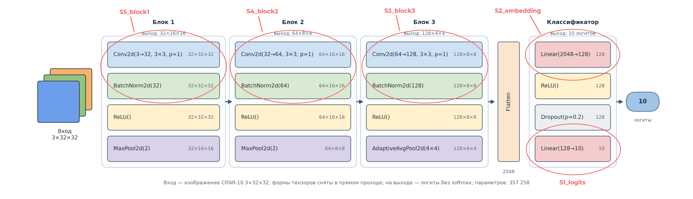

Каждый класс представляется в виде сплющенного в одно измерение тензора, затем по формуле
$\frac{\sum_{i=1}^{n} A_i B_i}{\sqrt{\sum_{i=1}^{n} A_i^2} \sqrt{\sum_{i=1}^{n} B_i^2}}$ считается косинусное сходство между классами разных моделей:

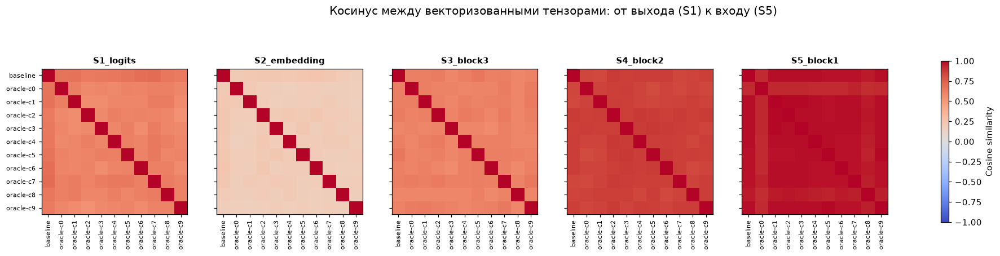

Косинусное сходство моделей на входе (`S5_block1`), очень похожи между собой и в среднем, относительно базовой модели составляет
$\approx 0.97$. Позже, будет показано, что без изменения слоя и почти без потерь точности этот слой можно переставлять между моделями. Также наблюдается тенденция, что чем ближе к выходу тем больше различий между моделями, но на слое эмбеддингов, косинусное сходство ниже чем на слое логитов, скорее всего это связано с очень большой размерностью этого слоя:
$2048 \cdot 128 = 262144$ против $128 \cdot 10 = 1280$.

$L_2$-расстояние также считается на сплющенном в одно измерение тензоре класса и дает похожее на косинусное сходство распределение.

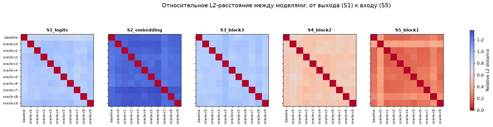

### Корреляция выходов

Посмотрим есть ли линейная корреляция на выходах слоев. Прогоним несколько примеров для всех классов в базовой модели, получим матрицу активаций $Y$ размером: *кол-во примеров* $\times$ *кол-во каналов слоя* и посчитаем среднее $\bar{Y}$ по столбцам. Сделаем тоже самое для всех оракулов ($X$ и $\bar{X}$) и посчитаем корреляцию Пирсона по формуле ($N$ - кол-во примеров):

$$r_{i,j} = \frac{\sum_{k=1}^N (Y_{k,i} - \bar{Y}_i)(X_{k,j} - \bar{X}_j)}{\sqrt{\sum_{k=1}^N (Y_{k,i} - \bar{Y}_i)^2} \sqrt{\sum_{k=1}^N (X_{k,j} - \bar{X}_j)^2}}$$

Получим распределения, в которых каждый элемент это значение корреляции Пирсона для $i$-канала в базовой модели и для $j$-канала в оракуле. Стадия `S5_block1`:

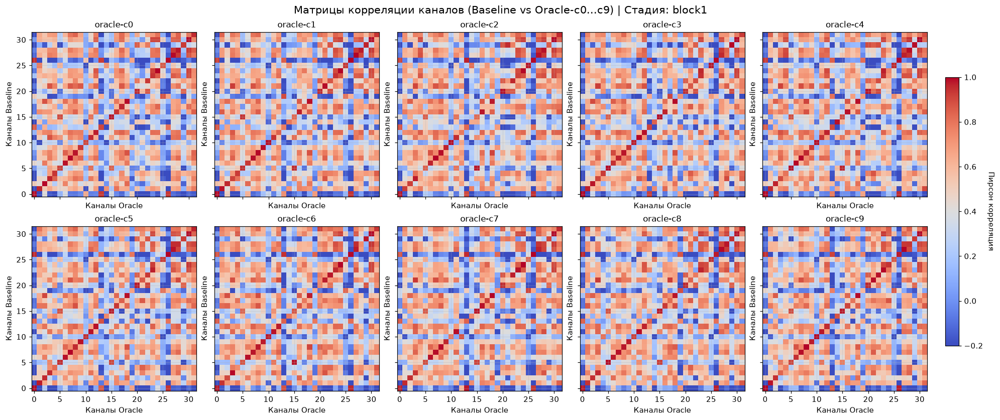

Стадия `S4_block2`:

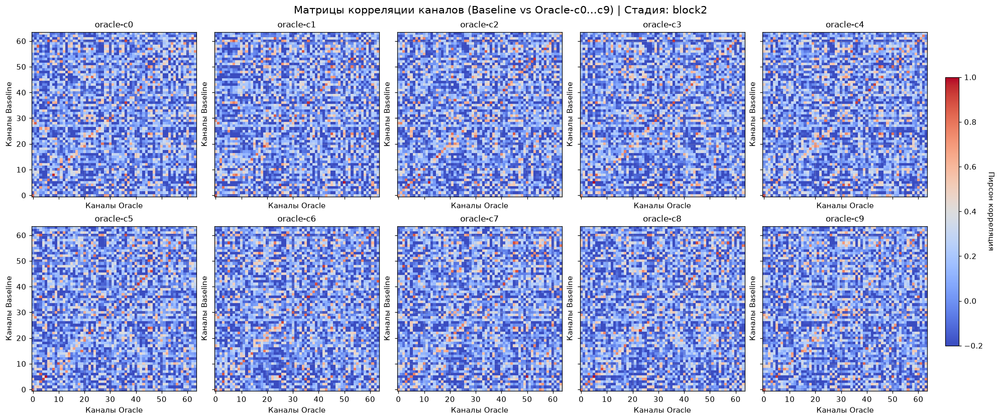

Стадия `S3_block3`:

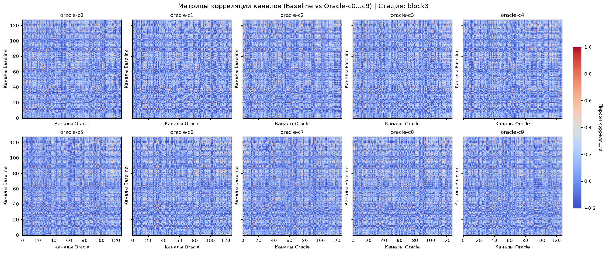

Сводная таблица. Метрики:

* $r_\text{same}$ - среднее значение корреляции Пирсона по тому же индексу. В распределениях берутся только те корреляции, где $i=j$ (красная линия как на стадии `S5_block1`) и по всем считается среднее
* $r_\text{best}$ - лучшая корреляция Пирсона для базовой модели (по строкам). В распределениях, в каждой из строк берется только лучшая корреляция и среди всех считается среднее
* $r_\text{opposite}$ - средняя корреляция противоположных каналов. В распределениях, в каждой из строк берутся только корреляции, где индекс строки $\neq$ индексу столбца (исключается красная линия как в `S5_block1`) и по всем значениям считается среднее
* $p_\text{match}$ - доля каналов, где лучшая корреляция Пирсона с тем же каналом. В распределениях, в каждой из строк берется лучшая корреляция и считается доля тех где индекс совпадает с индексом строки

|Стадия|$r_\text{same}$|$r_\text{best}$|$r_\text{opposite}$|$p_\text{match}$|
|------|---------------|---------------|-------------------|----------------|
|S5_block1|0.917|0.941|0.403|0.809|
|S4_block2|0.497|0.713|0.049|0.328|
|S3_block3|0.355|0.654|0.071|0.141|

На последних двух сверточных слоях $p_\text{match} < 0.33$, что может сигнализировать о перестановке каналов, поскольку хорошая корреляция для канала все равно иногда находится. На первом слое этого не произошло, хотя и в $19\%$ случаях лучшая корреляция оказывалась с другим каналом, но все равно корреляция с тем же каналом остается на высоком уровне.

Также на последнем сверточном слое лучшая корреляция в среднем $= 0.654$, то есть не всегда удается найти канал в оракуле, который бы коррелировал с каналом базовой модели, это может быть связано с функциональными изменениями слоя или с изменением координатного базиса. Рассмотрим 2 случая изменения координатного базиса: все линейные преобразования и только ортогональные (можно только поворачивать).

Сгенерируем матрицу $X$ размером *кол-во примеров (90)* $\times$ *кол-во каналов слоя (2)* и матрицу $Y$ такого же размера, повернув $X$ относительно начала координат: $Y = X \begin{pmatrix} \cos \theta & \sin \theta \\ - \sin \theta & \cos \theta \end{pmatrix}$. И посчитаем невязку, то есть то на сколько текущее положение точек $X_\text{new}$ близко к $Y$ (чем ближе к $0$ тем меньше распределения различаются):

$$\varepsilon = \frac{\Vert{}X_\text{new} - Y\Vert{}_F}{\Vert{}Y\Vert{}_F}$$
где:

* $\Vert{}A\Vert{}_F = \sqrt{\sum_{i,j} A_{ij}^2}$ - норма Фробениуса

Ортогональное изменение координатного базиса:

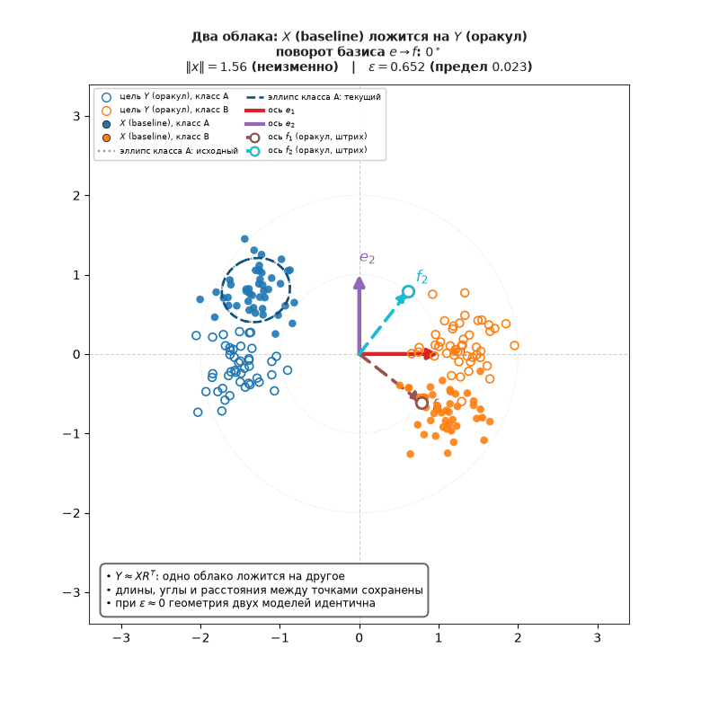

Бывают ситуации, где простое ортогональное изменение базиса не позволяет подогнать распределения:

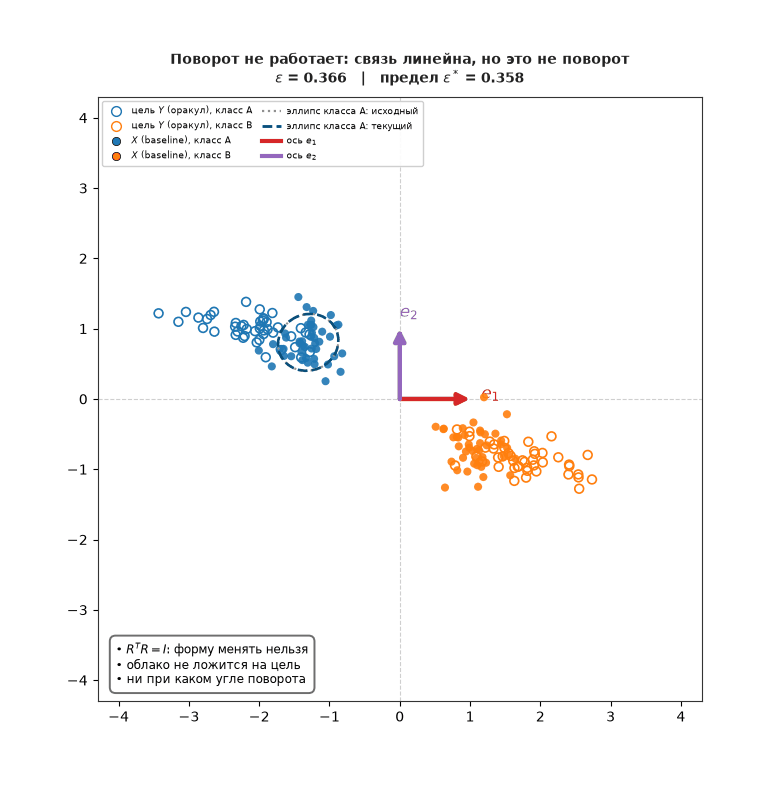

В этом случае можно использовать полное линейное изменение базиса, то есть не просто поворот, а растягивание, сжатие, перекашивание пространства:

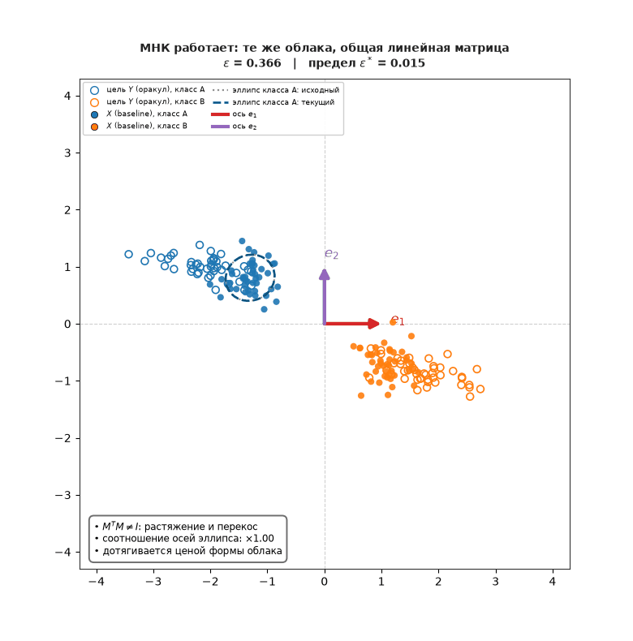

Но, оно тоже не всегда работает, что означает, что искажение нелинейно. Это можно интерпретировать как функциональные различия между 2 гипотетическими слоями, то есть две сети перестали описывать одно и то же в разных координатах и в их представлениях изменилось что-то не координатно:

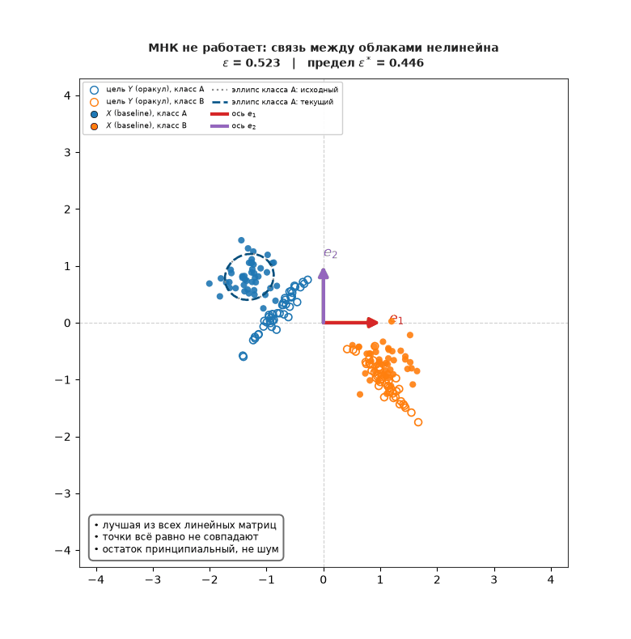

### Функциональное совпадение

Весовые метрики дают топологию, но не дают ответа на вопрос о вычислительной функции сети. Переход к CKA (Centered Kernel Alignment) решает это ограничение. CKA - это метрика сходства скрытых представлений, позволяющая количественно оценить, насколько одинаково два слоя видят одни и те же входные данные.

Вычисление CKA состоит из нескольких шагов. Первый - центрирование признаков, после прогона нескольких примеров, получается матрица активаций $Y$ размером: *кол-во примеров* $\times$ *кол-во каналов слоя*. По каждому столбцу считается среднее и вычитается из элементов матрицы, например для матрицы $Y = \begin{pmatrix} 1 & 1 \\ 2 & 0 \\ 0 & 2 \end{pmatrix}$, среднее $\mu_Y = [1, 1]$, тогда $\tilde{Y} = \begin{pmatrix} 0 & 0 \\ 1 & -1 \\ -1 & 1 \end{pmatrix}$. Второй шаг - вычисление грам матрицы: $K = \tilde{Y} \tilde{Y}^T$, после умножения получается квадратная матрица, где элементы это скалярное произведение между примерами. Тоже самое вычисляется и для второго слоя ($L$), с которым будет сравниваться первый. Тогда CKA вычисляется так:

$$\text{CKA} = \frac{\sum_{i,j} (K)_{ij} (L)_{ij}}{\sqrt{\sum_{i,j} (K)_{ij}^2 \cdot \sum_{i,j} (L)_{ij}^2}}$$

Такая метрика вычисляется для слоя эмбеддингов (`S2_embedding`) между оракулами и базовой моделью. Получается распределение, где элементы - это CKA между некоторым оракулом и базовой моделью на некотором классе. Например для airplane-оракула (индекс $0$) и объектов класса `cat` (индекс $3$) получается $\text{CKA} = 0.753$. То есть оракулу, который никогда не видел кошек и базовой модели показали кошек, получили $2$ матрицы активаций размером: *кол-во картинок* $\times$ *128 (кол-во выходов слоя эмбеддингов)* и посчитали метрику CKA. Полное распределение:

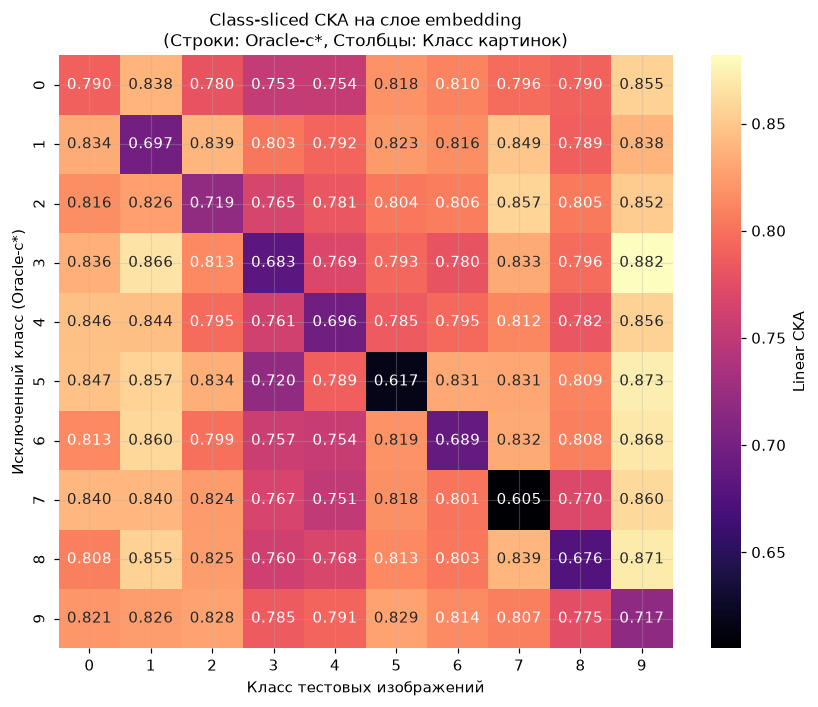

|Индекс|Класс|
|------|-----|
|0|airplane|
|1|automobile|
|2|bird|
|3|cat|
|4|deer|
|5|dog|
|6|frog|
|7|horse|
|8|ship|
|9|truck|

Поклассовый срез на слое эмбеддингов показывает наличие изолированного следа Unlearning. Средний CKA на сохраненных классах составляет $0.8125$, а на забытом классе проседает до $0.6890$. У $90\%$ оракулов минимальное значение CKA в строке приходится на тот класс, который был исключен из выборки, то есть максимальная разница в основном только на удаленных классах. На 9 классах, которые сеть должна помнить, сходство представлений с baseline удерживается в диапазоне $0.78–0.88$.

Посчитаем глобальное функциональное сходство между базовой моделью и всеми оракулами на всех классах. Для каждого оракула, вне зависимости от забытого класса прогоним объекты всех $10$ классов и получим матрицы активаций для слоев. Проделаем тоже самое для базовой модели, посчитаем CKA и возьмем среднее для всех $10$ пар $оракул \leftrightarrow baseline$ по слоям.

|Стадия|$\text{CKA}_\text{mean}$|$\text{CKA}_\text{min}$|$\text{CKA}_\text{max}$|
|------|------------------------|-----------------------|-----------------------|
|S5_block1|0.9896|0.9848|0.9936|
|S4_block2|0.9664|0.9609|0.9706|
|S3_block3|0.9429|0.9392|0.9452|
|S2_embedding|0.9224|0.8938|0.9374|

Средняя глобальная CKA на сверточных слоях держится в районе $0.9392-0.9936$, что доказывает, что сверточные слои между базовой моделью и оракулами совпадают функционально. Но, важно, что эта таблица показывает именно глобальную структуру пространства признаков и на примере слоя эмбеддингов это продемонстрировано. Там среднее значение CKA $= 0.9224$, что заметно выше, чем на по классовом CKA. Это связано с тем что глобальное CKA отражает взаимное расположение классов на общей карте у моделей. То есть, например, что у оракулов и у базовой модели кластер самолетов и кластер кошек лежит примерно одинаково далеко друг от друга. В то время как по классовый CKA показывает структуру внутри одного конкретного класса, а глобального расстояния до других классов там вообще нет. Модели сравниваются по нюансам конкретных классов: как они упорядочивают разные ракурсы, освещение, позы или текстуры объектов одного типа. В этих мелких деталях модели сходятся слабее.

Утверждать, что сверточные слои между моделями различаются только в разных базисах и перестановки каналов - нельзя, в различиях также может присутствовать по классовое (в нюансах объектов одного типа) функциональное расхождение.

## Трансплантация слоев

Сверточные стадии почти функционально не меняются от модели к модели: CKA $0.94-0.99$, а голова меняется сильно: на слое эмбеддингов по классовое CKA падает с $0.81$ на сохраненных классах до $0.69$ на забытом.

### Прямая перестановка слоев

Попробуем на прямую поменять слои между базовой моделью и airplane-оракулом и наоборот. Метрики:

* $\text{Acc}_\text{retain}$ - средняя точность на всех классах кроме самолетов (из выборки исключили самолеты, показали модели и посчитали среднюю точность)
* $\text{Acc}_\text{forget}$ - средняя точность только на самолетах (модели показали только самолеты и посчитали точность)
* $p_\text{forget}$ - вероятность, которую модель в среднем выдает, когда ей показывают самолеты
* Класс коллапса - с каким классом модель путает самолеты: класс кроме самолета, который модель чаще всего предпочитает, когда ей показывают самолеты. Например, когда базовой модели показывают самолеты, она в $88\%$ случаях относит его к классу самолет, в $3\%$ к классу корабль, в $2\%$ птица и т.д. В этом случае класс коллапса будет корабль

Метрики при переносе слоя из оракула в базовую модель ($baseline \rightarrow oracle$):

|Класс слоя|$\text{Acc}_\text{retain}$|$\text{Acc}_\text{forget}$|$p_\text{forget}$|Класс коллапса|
|----------|--------------------------|--------------------------|-----------------|--------------|
|(без переноса)|0.8393|0.8600|0.8119|ship|
|S5_block1|0.7519|0.8733|0.7710|ship|
|S4_block2|0.4319|0.5867|0.4738|cat|
|S5_block1+S4_block2|0.4741|0.4800|0.4021|automobile|
|S3_block3|0.4556|0.2400|0.2342|ship|

Метрики при переносе слоя из базовой модели в оракула ($oracle \rightarrow baseline$):

|Класс слоя|$\text{Acc}_\text{retain}$|$\text{Acc}_\text{forget}$|$p_\text{forget}$|Класс коллапса|
|----------|--------------------------|--------------------------|-----------------|--------------|
|(без переноса)|0.8607|0.0000|0.0000|ship|
|S5_block1|0.7859|0.0000|0.0000|ship|
|S4_block2|0.4630|0.0000|0.0000|bird|
|S5_block1+S4_block2|0.5281|0.0000|0.0000|bird|
|S3_block3|0.4126|0.0000|0.0000|ship|

Модель выдерживает прямую пересадку $S5$ с сохранением $\approx 75–79\%$ точности. Это показывает, что низкоуровневые детекторы жестко зафиксированы начальным сидом и одинаковы у всех моделей.

При попытке пересадить $S4$ или $S3$ точность модели падает с $84\%$ до $41–46\%$. Это доказывает вывод из анализа корреляций каналов: в блоках $S4$ и $S3$ произошла перестановка каналов и смена координатного базиса и если взять сырой тензор $S4$ оракула и вставить его в базу, то получится так, что следующий блок ожидает старую раскладку признаков по каналам, а получает перемешанные. Происходит внутренний рассинхронизация представлений, разрушающий прямой проход.

### Обучаемый линейный слой

Веса головы базовой модели и оракулов почти ортогональны, прямой перенос не даст результатов, произойдет тоже самое, что и в предыдущем блоке. Проверяем, можно ли не переносить веса, а сшить модели: ствол одной модели заморожен, голова другой
заморожена, между ними обучаемый линейный слой, который находится сразу после Flatten слоя.

Существует несколько вариантов сделать такой обучаемый слой, начнем с простого - вообще без слоя, чтобы подтвердить рассинхронизацию представлений при прямой пересадке. Исходные метрики моделей (вообще без пересадки):

|Модель|$\text{Acc}_\text{retain}$|$\text{Acc}_\text{forget}$|
|------|--------------------------|--------------------------|
|baseline|0.8393|0.8600|
|airplane-oracle|0.8607|0.0000|

Метрики после пересадки головы оракула на ствол базовой модели:

|$\text{Acc}_\text{retain}$|$\text{Acc}_\text{forget}$|
|--------------------------|--------------------------|
|0.5889|0.000|

Точность модели падает на $9$ классах (на всех кроме самолета): $0.8393 \rightarrow 0.5889$. Попробуем с помощью метода наименьших квадратов найти матрицу перехода. Пропустим через сверточный слой базовой модели примеры и получим матрицу активаций $X$, активации фиксируем после Flatten слоя, но до первого линейного слоя. Получим матрицу размером: *кол-во примеров* $\times$ *2048 (размерность вектора, который подается на первый линейный слой)*. Затем найдем центрированную матрицу $X_c$: в матрице $X$ посчитаем среднее по столбцам и вычтем полученный вектор из каждой строки. Сделаем тоже самое для airplane-оракула и получим матрицу $Y_c$. Теперь нужно найти матрицу перехода $G$, размером: $2048 \times 2048$, такую, что $X \cdot G \approx Y$. Такую матрицу можно найти по формуле:

$$G = (X_c^T X_c + I)^{-1} X_c^T Y_c$$

Найдем $G$ поставим между слоями и посчитаем метрики. Также посчитаем метрику $residual$, она покажет на сколько сильно предсказанные значения матрицей $G$ отличаются от фактических. Эта метрика будет считаться как относительная невязка по норме Фробениуса:

$$\text{residual} = \frac{\Vert{}X_c G - Y_c\Vert{}_F}{\Vert{}Y_c\Vert{}_F}$$

где:

* $\Vert{}M\Vert{}_F = \sqrt{\sum_{i,j} M_{ij}^2}$ - норма Фробениуса

Получим такие метрики:

|$\text{Acc}_\text{retain}$|$\text{Acc}_\text{forget}$|$residual$|
|--------------------------|--------------------------|----------|
|0.8301|0.000|0.4249|

Получилась модель, которая почти не просела в точности по сравнению с базовой моделью, но не много просела (на $3\%$) по сравнению с оракулом: ожидалось что получится в точности оракул из базовой модели.

МНК не дает проверить гипотезу о том, что модели различаются только базисом, поскольку он способен сминать, растягивать и подгонять искаженные пространства друг под друга. Используем ортогональный Прокруст: ему запрещено менять форму облака точек, он имеет право только повернуть его как единое твердое тело. Найдем решение задачи Прокруста - матрицу $R$, такую, что $R^TR=I$ и
$X \cdot R \approx Y$. Используем сингулярное разложение матрицы $M = X_c^TY_c$, тогда $M = U \Sigma V^T$, из которой выбросим $\Sigma$ отвечающую за растяжения/масштаб вдоль осей:

$$R = UV^T$$

Найдем $R$ поставим между слоями и посчитаем метрики:

|$\text{Acc}_\text{retain}$|$\text{Acc}_\text{forget}$|$residual$|
|--------------------------|--------------------------|----------|
|0.8280|0.000|0.5450|

Точность получилась $= 0.8280$. Значит разница между выходом сверток базовой модели и оракула носит линейный характер. Представления признаков базы и оракула не сжаты и не деформированы относительно друг друга - они просто повернуты в пространстве.

## Кастомный метод Unlearning

### Идея

Знание модели о классе $c$ - это его геометрический след в пространстве признаков:
сдвиг среднего и форма ковариации (вторые моменты), а не отдельные объекты. Облако класса $c$ надо перевести туда, где
оказались бы его объекты, если бы класса не было, то есть в геометрию остальных классов.

### Формулировка

Процесс состоит из 3 шагов.

Шаг 1. Расчет целевого распределения ($\mu_r$ и $\Sigma_r$). Забываемый класс $c$ полностью исключается из выборки. Рассматриваются только оставшиеся классы $k \neq c$ (индекс $r$ означает retained - сохраненные). Расчет целевого центра:

$$\mu_r = \frac{1}{\vert{}K \setminus c\vert{}} \sum_{k \neq c} \mu_k$$

* $K$ - множество всех классов, для CIFAR10 - $\{0, 1, \dots, 9\}$
* $c$ - элемент забываемого класса, например - $0$
* $\mu_k$ - центр распределения класса

Целевая форма разброса:

$$\Sigma_r = \sum_{k \neq c} \frac{n_k\Sigma_k}{\sum_{j \neq c} n_j}$$

* $n$ - количество картинок класса
* $\Sigma_k$ - ковариационная матрица класса

Шаг 2. Расчет матрицы трансформации $A$. Вычисляется матрица $A$, которая отвечает за вращение, сжатие и растяжение пространства признаков:

$$A = \Sigma_r^{1/2} \Sigma_c^{-1/2}$$

* $\Sigma_c^{-1/2}$ - обеляет данные (сжимает эллипсоид забытого класса в сферу)
* $\Sigma_r^{1/2}$ - перекрашивает данные (растягивает полученную сферу в форму эллипсоида смеси остальных классов)

Шаг 3. Перенос в веса. Трансформация $h \to \tilde h$ должна переводить признак $h$ по формуле:

$$\tilde h = \mu_r + A(h - \mu_c)$$

Линейный классификатор вычисляет логиты классов по стандартной формуле:

$$y = W h + b$$

Вместо того чтобы изменять каждый входной вектор признаков $h$ при инференсе, подставим формулу преобразованного вектора $\tilde h$ прямо в уравнение слоя:

$$y = (WA)h + \Big( b + W(\mu_r - A\mu_c) \Big)$$

Отсюда следуют правила обновления весов:

1) $W \leftarrow W A$
2) $b \leftarrow b + W(\mu_r - A\mu_c)$

Что происходит со слоем с двумя каналами показано на графиках:

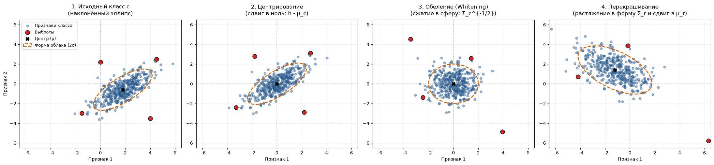

### Проверка

| Вариант | $p(\text{класс }0)$ | Энтропия ответов | Топ ответов |
| :--- | :--- | :--- | :--- |
| база, как есть | 0.797 | 0.413 | 0:0.80, 2:0.05, 8:0.04 |
| база + транспорт класса 0 | 0.086 | 1.259 | 3:0.20, 2:0.16, 9:0.10, 5:0.09 |
| `oracle-c0` (эталон) | 0.002 | 0.982 | 2:0.32, 8:0.24, 1:0.11, 4:0.10 |
| контроль: точность на 9 классах | до 0.8291 -> после глобальной карты 0.7849 | | |

Правка без обучения уменьшает $p$ в 9 раз и воспроизводит
масштаб разброса оракула, при этом точность не сильно падает. Но не получилось достичь уровень $p$ оракула (0.086 против 0.002), а также разброса по классам (3/2/9/5 против 2/8/1/4).

## Обзор исследований

Методы Unlearning в новых исследованиях в основном работают с геометрией классов, то есть по похоже принципу, что и описанный в предыдущем блоке метод. Метод из предыдущего блока хоть и называется "кастомным", но не является полностью уникальным, кроме того, есть, например, метод [POUR](https://arxiv.org/abs/2511.19339), который работает по похожему принципу, но гораздо лучше обоснован математически.

Для языковых моделей также существует много разных методов и метрик, даже [есть](https://arxiv.org/abs/2607.19442) уже обученные оракулы, как в этом исследование, только это языковые модели, а не простые CNN.

Можно попробовать не изобретать новый метод (там ниша занята: POUR, DAMP, MU-OT, SCAR, LEACE, AdaIN) или метрику, а доказать то, что метод сработал. Суть в том чтобы сделать строгий протокол проверки, и проверить существующие методы им. Поскольку сид, порядок данных и шум обучения двигают модель так же сильно, как эффект, который пытаются сертифицировать, забывание надо определять не абсолютным порогом, а попаданием в шумовую полосу облака оракулов после приведение параметров (или представлений) двух сетей к одному и тому же координатному базису (gauge-коррекция). В начале этого файла, в блоке про обучение, было расписано, что в изначальном варианте обучения всех моделей был баг из-за которого исходные сиды моделей не совпадали, но на самом деле это был не баг, просто получились не gauge-эквивалентные модели у которых, например, первый сверточный слой очень сильно отличался и просто так его переставить было нельзя.

Шаги:

1. Дообучить $5-8$ оракулов на каждый забытый класс с разным сидом/порядком данных/инициализацией и получить тем самым облако оракулов для забытого класса $c$ (сейчас облако оракулов состоит только из одного оракула, а нужно больше)
2. Измерить послойно шумовую полосу репликации: CKA, Прокруст-выровненное направленное расстояние, доля совпавших каналов между оракулами одного класса. Смысл в том что расстояние между 2 оракулами одного и того же класса - это эталонный шум (они забыли одно и то же, значит любое расхождение это шум). Собрав попарные расстояния, получаем полосу: интервал, внутри которого различаются модели, забывшие одинаково. Это и есть полоса репликации, то есть порог, ниже которого различие между базовой моделью и оракулами неотличимо от случайного
3. Определить критерий $d(M, \text{cloud}) \le$ полосы и проверить на отложенном сиде (фальсифицируемость). $d(M, \text{cloud})$ это расстояние между разобученной моделью и облаком оракулов, если разобученная модель входит в это облако оракулов (полосу репликации) - это означает, что модель действительно забыла конкретный класс
4. Взять известные методы разобучения (GA/NPO, SCRUB, boundary, POUR), применить их к базовой и посчитать несколько метрик:
$d(M, \text{cloud})$, входит ли $d(M, \text{cloud})$ в полосу репликации, поведенческое совпадение распределения

Это не уникальный план, поскольку есть такие исследования: [On the importance of multiple training seeds for evaluating machine unlearning](https://arxiv.org/abs/2510.26714), [Deep Unlearn: Benchmarking Machine Unlearning for Image Classification](https://arxiv.org/abs/2410.01276). Но можно их воспроизвести на своем стенде и протестировать свежие методы unlearning.
